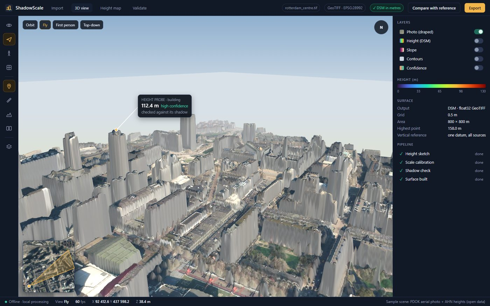
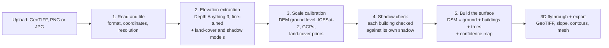
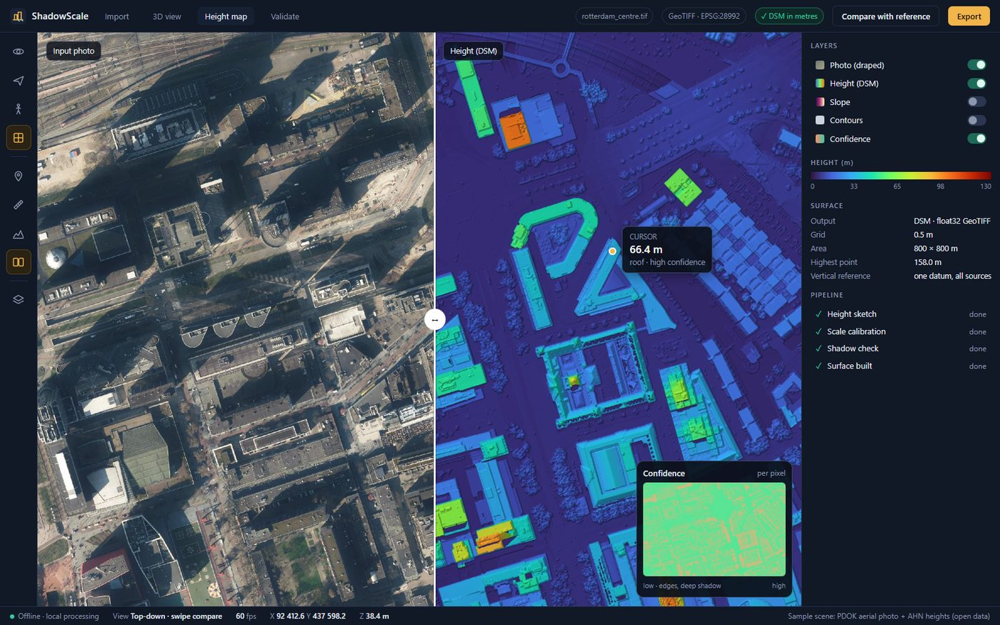
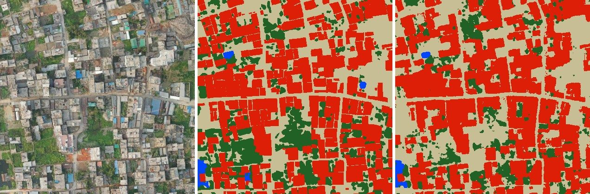

# ShadowScale AI

Single-view height estimation and 3D flythrough from one optical satellite image.

Upload one RGB image. ShadowScale AI estimates the height of every building, tree and patch of ground, builds a Digital Surface Model (DSM) and drapes the image on a 3D terrain mesh that you can walk and fly through, measure and check against reference data.

▶ **[Product page](https://shadowscale-ai.vercel.app)**

Interface preview. The sample scene uses an open aerial photo and open LiDAR heights (PDOK / AHN, Rotterdam) to show how results are displayed.

---

## The problem

Height data today comes from stereo image pairs, LiDAR surveys or radar interferometry (InSAR). These are cost-prohibitive, depend on specific sensor availability and are computationally intensive. Most places, and most disaster sites, only have a single optical image.

Monocular depth models can read depth from one photo, but they are trained on street-level (egocentric) photos. From above they face a domain gap, and they only give relative depth: they can say one roof is higher than another, but not by how many metres.

ShadowScale AI closes both gaps: it adapts a pre-trained monocular depth backbone to top-down satellite images and gives heights in real metres.

---

## What you get

| You upload | You get |
|---|---|
| GeoTIFF that lines up well with ground data | **Absolute DSM** in metres + a confidence value for every pixel |
| PNG or JPG (no coordinates) | **Relative DSM (rDSM)**: heights in true proportion to each other, clearly marked "no scale" |
| GeoTIFF with a weak match to ground data | Relative heights in true proportion, weak areas flagged. Adding 3 to 6 ground control points (GCPs) turns them into metres |

Every result can be exported as a GeoTIFF DSM, slope map, contour lines and a 3D mesh.

---

## How it works

### 1. Read and tile

The input is checked for format, coordinates and resolution. Large images are cut into overlapping tiles and stitched back together without visible seams.

### 2. Elevation extraction

- **Depth Anything 3**, a pre-trained monocular depth backbone, is fine-tuned on satellite images with LiDAR heights. After fine-tuning it outputs **height above ground in metres** directly, not just relative depth.
- **Two SegFormer-B2 models** run on the same image:
  - a **land-cover model** that marks buildings, trees, water and open ground
  - a **shadow model** that marks shadows

### 3. Scale calibration

Heights need a correct ground level and a correct scale. For GeoTIFF inputs:

- **Ground level** comes from a free low-resolution DEM (FABDEM, or SRTM). The fit uses many open-ground pixels, so a few bad DEM pixels do not shift the result.
- **ICESat-2** laser points, where a satellite track crosses the image, give an extra height check.
- **GCPs**, if the user adds a few, fix the scale exactly.
- **Semantic priors** from the land-cover map keep heights sensible: water is flat, roads sit on the ground.

### 4. Shadow check

A building's shadow is a direct measurement of its height:

**height = shadow length × tan(sun elevation)**, corrected for a tilted satellite view and for sloping ground.

- **Sun direction** is read from the shadows in the image itself.
- **Sun elevation** comes from the image metadata. If that is missing, it is calculated from the acquisition date, time and location. If that is missing too, it is solved from the calibrated heights of many buildings plus the latitude.
- **Only clean shadows are used.** A shadow counts only if it starts at the roof edge, ends on open ground inside the image, has no other building in its path and can be measured along at least 5 lines.
- **Roof shape decides where to measure from.** Flat roofs are measured from the roof edge, sloped roofs from the ridge. The roof type is read from the height map (a flat roof has an even top, a sloped roof rises to a ridge).
- The shadow height is blended with the model's height for each building, weighted by how clean the shadow is. Shadows **correct** the heights; the fine-tuned model **produces** them.

**When a shadow cannot be used**

| Situation | What happens |
|---|---|
| Shadow hidden, too short or under cloud | The model's height is kept for that building, with lower confidence |
| Too few clean shadows in the whole image | The shadow step is skipped; heights come from calibration only and are flagged |
| PNG / JPG with no sun angle | Shadow ratios are used instead: if building A's shadow is twice building B's, A is twice as tall. No sun angle needed |
| Small, low buildings in low sun | Short shadows merge with trees and neighbours, so the model's height is trusted and the shadow gets little or no weight |

### 5. Build the surface

The DSM is assembled as ground + buildings + trees, on one pixel grid with the photo. Every pixel carries a confidence value, so the user can see which heights are measured well and which are estimates.

---

## 3D flythrough

Interface preview. Sample scene: open aerial photo and LiDAR heights (PDOK / AHN, Rotterdam).

- The image is draped on the 3D terrain mesh and navigated in real time: **orbit, fly, first-person walk and top-down** views.
- **Click any building** to see its structural height and confidence.
- **Draw a line** to get the elevation and slope profile along it.
- **Layers:** photo, height (DSM), slope, contours and confidence.
- **Compare with reference:** load a reference DSM and get RMSE, MAE and correlation for the scene.
- Large scenes use a tiled level-of-detail mesh, so millions of points stay smooth to navigate.
- Built with **Three.js / WebGL** inside a **Tauri** desktop app for Windows and Mac. It runs locally and works offline, so sensitive imagery never leaves the machine.

---

## Test results

All tests use areas that were never seen during training. Ground truth is airborne LiDAR.

### Building heights (S-EO dataset, WorldView-3 satellite images)

49 unseen areas, **12,549 buildings**, in three US cities.

| Step | Average error per building (MAE) | RMSE | Within 2 m of LiDAR |
|---|---|---|---|
| Depth Anything 3 as published (no fine-tuning) | 5.7 m | 25.0 m | 27% |
| + fine-tuned on satellite LiDAR heights | 2.4 m | 4.0 m | 61% |
| **+ shadow check per building (ShadowScale AI)** | **2.25 m** | **3.9 m** | **66%** |

Fine-tuning cut the error by more than half, and the shadow check improved it again. The correlation between our heights and LiDAR heights is 0.56.

**By area:**

| Area | Landscape | Buildings | MAE |
|---|---|---|---|
| San Diego | Hilly | 2,670 | **1.5 m** |
| Jacksonville | Flat, urban and suburban | 3,683 | 2.3 m |
| Omaha | Flat, urban and suburban | 6,196 | 2.9 m |

On hilly ground the DEM sets the ground level and shadows are slope-corrected, so heights stay accurate where the terrain is not flat.

**Shadow check:** heights computed from our own land-cover and shadow models were as accurate as heights computed from perfect, LiDAR-derived building and shadow masks (3.1 m vs 3.4 m average error on about 2,800 buildings). The two SegFormer models are good enough for the job.

### Land cover (OpenEarthMap, 44 countries)

384 validation images the model never trained on.

| Class | Score (IoU) |
|---|---|
| Building | **80.0%** |
| Tree | **71.6%** |
| Water | **82.0%** |
| Open ground | **85.0%** |
| Average over these 4 classes | **79.7%** |

On the full 8-class OpenEarthMap task our model scores 67.7% mean IoU (published SegFormer result: 66.0%). On the 15 South Asian images in the set, building IoU is 79.5%, close to the global score.

Dhaka, unseen image. Left: photo. Middle: true map. Right: our model. Red: buildings, green: trees, blue: water.

### How the models were trained

| Model | Data | Training |
|---|---|---|
| Depth Anything 3 (Base), heights in metres | S-EO: WorldView-3 images with LiDAR heights and sun angles, split by area (no test area used in training) | 3,000 steps, L1 loss in metres, about 35 minutes on one GPU |
| SegFormer-B2, land cover | OpenEarthMap, 2,303 training tiles | 24,000 steps |
| SegFormer-B2, shadows | S-EO shadow masks, split by area | 8,000 steps |

Training is short and runs on a single GPU, so adding a new city or sensor only needs a short fine-tune.

---

## Stable across landscapes

| Landscape | How ShadowScale AI handles it |
|---|---|
| **Urban** | Fine-tuned on satellite LiDAR heights; every building checked against its own shadow |
| **Sparse** | Clean shadows fall on open ground; FABDEM and ICESat-2 set the ground level |
| **Hilly** | Ground from the DEM; shadow lengths corrected for slope (1.5 m error on hilly San Diego) |
| **Forest** | Tree heights from canopy-height training (the Depth Any Canopy approach); bare ground from FABDEM |

Each landscape gets its own score. Urban and hilly results are shown above; sparse and forest areas are in the next test round.

---

## Next training steps

The tests above come from a short proof run. The full product training adds:

1. **A larger backbone and all the data.** Fine-tune Depth Anything 3 Large on all of S-EO plus other satellite height sets such as US3D (DFC2019).
2. **Roof-type rule learned from data.** Learn the edge-versus-ridge correction for sloped roofs on training areas only, so pitched-roof houses are measured from the right point.
3. **Hilly and forest test areas.** Test on Maxar Open Data satellite images (which include sun elevation, sun azimuth and off-nadir angle) with USGS 3DEP LiDAR as truth, and report RMSE, MAE and correlation per landscape.
4. **Tree heights.** Add canopy-height training so forest heights come from a model tuned for trees.
5. **India check.** Run on Indian scenes (for example the Maxar India flood images) and compare building heights with Google Open Buildings 2.5D, which covers India.
6. **Sun angle unknown vs known.** Report results both with and without metadata, and with and without the shadow check, so each part's value is measured.

---

## Who it is for

| Area | Use |
|---|---|
| Disaster management | Collapsed buildings, roofs above flood water, risky slopes |
| Urban planning and smart cities | Building heights, zoning, digital twins, heat and airflow studies |
| Defence and security | Terrain and line of sight for military reconnaissance |
| Forests and climate | Tree height for biomass and carbon stock |
| Telecom and energy | 5G link planning around obstacles, rooftop solar shade |
| Population and housing | Building volume for population and housing estimates |

| Today | With ShadowScale AI |
|---|---|
| Stereo pairs, LiDAR or InSAR: cost-prohibitive | One optical image already in hand |
| Depend on specific sensor availability | Any RGB image, even PNG / JPG |
| Computationally intensive | Runs on one laptop, offline |
| Static elevation profiles | Interactive 3D, navigated in real time |

---

## Technologies

| Area | Tools |
|---|---|
| AI and vision | Depth Anything 3, SegFormer, PyTorch, Hugging Face, ONNX Runtime |
| Geospatial | GDAL, Rasterio, pyproj, FABDEM, SRTM, ICESat-2, GeoTIFF |
| 3D and app | Three.js, WebGL, Tauri (Windows and Mac) |
| Backend | Python, FastAPI, runs locally and offline |

## Data

| Dataset | Used for |
|---|---|
| **S-EO** (WorldView-3 images + LiDAR + sun angles) | Training and testing the height and shadow models |
| **OpenEarthMap** (44 countries) | Training and testing the land-cover model |
| **USGS 3DEP** | True ground level on hilly terrain |
| **FABDEM**, **SRTM** | Ground level during scale calibration |
| **ICESat-2** | Laser height points for checking ground and scale |
| **Maxar Open Data + USGS 3DEP LiDAR** | Next step: hilly and forest testing |

---

## References

1. Depth Anything 3, ByteDance, 2025. [arxiv.org/abs/2511.10647](https://arxiv.org/abs/2511.10647)
2. HTC-DC Net, IEEE TGRS 2023. [arxiv.org/abs/2309.16486](https://arxiv.org/abs/2309.16486)
3. SegFormer, NeurIPS 2021. [arxiv.org/abs/2105.15203](https://arxiv.org/abs/2105.15203)
4. Depth2Elevation, IEEE TGRS 2025. [ieeexplore.ieee.org/document/10978076](https://ieeexplore.ieee.org/document/10978076)
5. Building height from shadow length, 42 cities, 2024. [arxiv.org/abs/2411.09411](https://arxiv.org/abs/2411.09411)
6. Depth Any Canopy, ECCV 2024 Workshops. [arxiv.org/abs/2408.04523](https://arxiv.org/abs/2408.04523)
7. Single-image building height, Remote Sensing 2026. [doi.org/10.3390/rs18050801](https://doi.org/10.3390/rs18050801)
8. FABDEM, Environmental Research Letters 2022. [doi.org/10.1088/1748-9326/ac4d4f](https://doi.org/10.1088/1748-9326/ac4d4f)
9. ICESat-2 ATL08, NASA. [nsidc.org/data/atl08](https://nsidc.org/data/atl08)
10. Google Open Buildings 2.5D. [sites.research.google/gr/open-buildings](https://sites.research.google/gr/open-buildings)
11. US3D / DFC2019, WACV 2019. [arxiv.org/abs/1811.08739](https://arxiv.org/abs/1811.08739)
